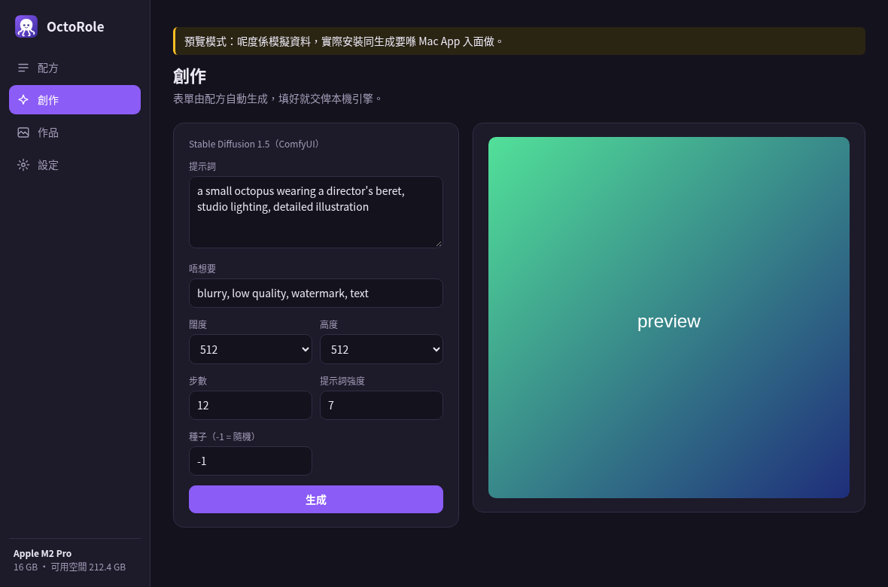
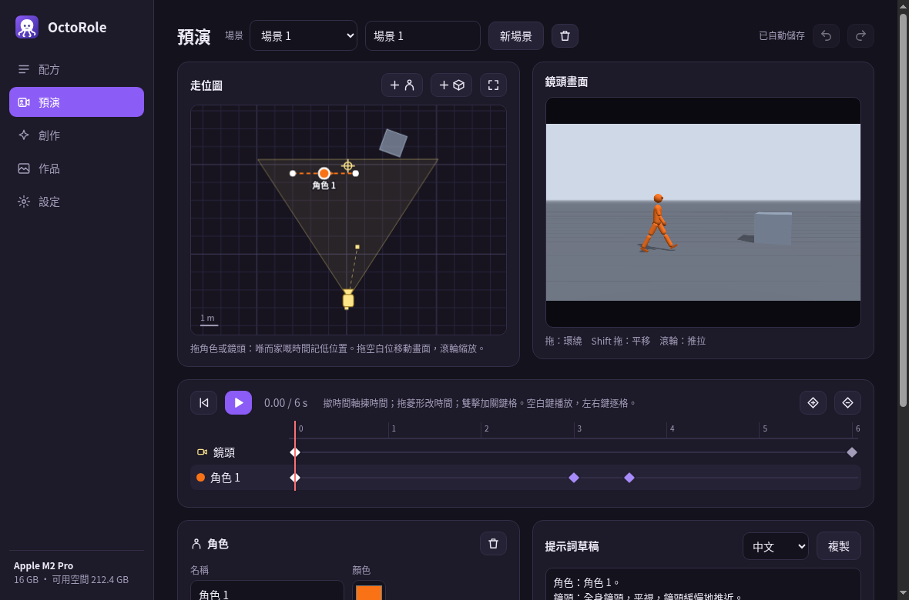

# OctoRole

[Mac App Store 版操作教學（附實機截圖）](store/README.md) · [私隱政策](docs/App-Store-Privacy.md)

Mac 上面嘅本機 AI 配方部署器（Tauri 2：Rust 後端 + 原生 JS 介面）。
揀一個配方，OctoRole 就會下載模型、逐個檔案核對 SHA-256、裝好本機引擎，然後用配方自動生成嘅表單去創作。全部喺你部 Mac 上面行。

## 下載及安裝 v0.6.1

**邊部 Mac 用到？** v0.6.1 安裝包適用於 Apple Silicon（M 系列）Mac，例如配備 M 系列晶片嘅 MacBook Air、MacBook Pro、iMac、Mac mini、Mac Studio 或 Mac Pro。Intel Mac 無法運行呢個 arm64 安裝包。撳  →「關於此 Mac」可以睇晶片、記憶體同 macOS 版本。

| 用途 | 系統及硬件 |
|---|---|
| 安裝 OctoRole | 安裝包標示最低 macOS 13.0。實測配置包括 MacBook Pro（M5 Max、128 GB、macOS 26.6.2）及 Mac Studio（M5 Ultra、256 GB、macOS 27.2）。 |
| 用 HyperFlow H3 本機生成影片 | 本版教學引擎要求 macOS 26.2 或更新。由零安裝需完整版 Xcode、Metal 工具鏈及 FFmpeg。模型同引擎預留約 40 GB，另計 Xcode、暫存及影片空間。 |
| 原生 1080p 生成 | 已喺上述 Mac Studio 生成 1920 × 1080 角色特寫。記憶體需要隨解像度、格數同其他正在執行嘅程式而變；最低統一記憶體仍未實測確定。 |

**Mac mini 64 GB 同 MacBook Pro Max**：先睇「關於此 Mac」嘅晶片。M 系列 Mac mini（例如 M4 Pro 64 GB）同配備 Max 晶片嘅 MacBook Pro 都符合 App 架構要求；Mac mini 64 GB 嘅 H3 效能仍未實機驗證。GitHub v0.6.1 安裝包內置六鏡固定用 1024 × 576。`main` 原始碼版可喺「HyperFlow H3 → 鏡頭 → 輸出解像度」揀 512 × 288、1024 × 576、1280 × 720 或 1920 × 1080。建議先用細尺寸試構圖，再按可用記憶體提高解像度。

第一次用新版，可以一邊睇 [v0.6.1 項目圖解](docs/Project-Walkthrough.md)，一邊跟 [廣東話教學片（約 59 秒）](docs/tutorial/OctoRole-0.6.1-projects-yue.mp4) 操作。

1. 用 Apple Silicon Mac [下載 OctoRole v0.6.1（Mac ZIP）](https://github.com/Octopus-InfoTech-Limited/OctoRole/releases/download/v0.6.1/OctoRole-0.6.1-Mac.zip)，解壓後將 **OctoRole.app** 拖入「應用程式」。
2. 開啟 OctoRole。呢個版本採用本機 ad-hoc 簽署，未經 Apple 公證。如果 macOS 阻止開啟，確認下載來源係本公司 Release；如你信任呢個版本，可以喺「系統設定 → 私隱與保安」揀「仍要開啟」。
3. 想先試排鏡，開「預演」，連接本機 Qwen 文字模型。想生成影片，開「HyperFlow H3 → 鏡頭」安裝引擎。H3 教學環境需要 macOS 26.2 或更新、完整版 Xcode 同 FFmpeg，並預留約 40 GB 畀模型同引擎。[H3 安裝步驟](docs/HyperFlow-Walkthrough.md)
4. 想為已有影片配音，可以直接開「HyperFlow H3 → 角色配音」，撳「安裝本機聲線」，再跟下面嘅截圖教學操作。模型會另行下載。

## 項目工作流程

開啟 OctoRole 後，喺「項目」建立或選擇一套劇，再開「預演」編輯場景、「HyperFlow H3」生成六鏡短劇或配音，最後去「作品」睇成片。既有作品可以喺「預設工作區」搵返。各項目共用已安裝嘅模型同引擎。

「項目」右邊嘅進度每五秒更新，顯示已完成段數、百分比同各集進度。六鏡短劇會自動建立進度表。外部批次可以喺項目資料夾寫入 `production-plan.json`，格式如下。每段列出必須完成嘅檔案；每集嘅最終檔案齊備後，清理中間素材亦會保留完成狀態。路徑相對於項目資料夾。

```json
[{"label":"E01","steps":[["shots/01-yue.mp4","shots/01-cmn.mp4"]],"outputs":["works/E01-yue.mp4","works/E01-cmn.mp4"]}]
```

內置一個創作配方時，可以喺「設定 → 管理配方」安裝或啟動引擎。加入第二個配方後，側欄會顯示「配方」。HyperFlow H3 有獨立入口。

## 跟住教學做一次

[實機圖解：分鏡、角色參考相、雙語配音、字幕及配樂](docs/Dialogue-Walkthrough.md) · [廣東話操作影片（4 分 33 秒）](docs/tutorial/OctoRole-0.6-walkthrough-yue.mp4) · [繁體字幕 SRT](docs/tutorial/OctoRole-0.6-walkthrough-yue.srt)

影片由本機 Qwen 分鏡開始。想直接睇角色相，由 3:38 開始；4:00 可以試聽角色對答，4:07 示範配樂同環境聲。



## 喺 Mac 上面 build

需要：Apple Silicon Mac、Xcode Command Line Tools（`xcode-select --install`）、[Rust](https://rustup.rs)、Node.js 18+。

```bash
cd OctoRole
npm install
npm run dev      # 開發模式，改介面即時見到
npm run build    # 出 OctoRole.app 同 .dmg，喺 src-tauri/target/release/bundle/
```

淨係想睇介面（唔使 Mac）：`npm run preview`，然後開 `http://localhost:4173/ui/`。呢個係模擬資料。

## 預演（0.2.0 新增）



排好人物走位同鏡頭，匯出一段參考影片、一張畫面同一份提示詞草稿，再交俾影片模型。全部係 OctoRole 自己設計同寫嘅。

- **走位圖**（俯視）：拖角色、道具、鏡頭同鏡頭對焦點。拖角色或鏡頭會喺而家嘅時間記低一個關鍵格。
- **鏡頭畫面**（3D）：拖係環繞，Shift 拖係平移，滾輪係推拉，同樣會記低關鍵格。
- **時間軸**：撳揀時間，拖菱形改時間，雙擊加關鍵格。空白鍵播放，左右鍵逐格，K 加關鍵格，Delete 刪關鍵格，Cmd+Z 還原。
- **角色**：行同跑會按速度自動出步行動畫；企定嗰陣可以揀姿勢（企、坐、踎、揮手、指、舉手、瞓低）同面向。
- **鏡頭**：高度、視角、跟住某個角色、慢起慢停或等速。
- **提示詞草稿**：由走位同鏡頭自動寫成（景別、角度、鏡頭運動、每個角色喺畫面入面點郁），英文或中文。
- **匯出**：`~/OctoRole/previs/<場景>/` 入面有 `previs.mp4`（或 `.webm`）、`control.png`、`still.png`、`prompt.txt`、`scene.json`。場景會自動儲存。

`control.png` 係俾影片模型用嘅**深度畫格**：成個鏡頭逐格畫成深度圖（近白遠黑），每秒 16 格、最多 81 格（5 秒），包成一個動畫 PNG。佢係逐格計出嚟，唔靠實時錄影，所以時間準、匯出快，就算部機錄唔到參考影片都照樣出到。

## 點用

1. **配方**：撳「安裝」。下載可以隨時取消，下次由中斷位置繼續。
2. 裝好之後撳「啟動引擎」，再撳「去創作」。
3. **創作**：填表單，撳「生成」。成品自動存入「作品」。
4. **設定**：改資料夾位置（模型好大）、填 Hugging Face 權杖、轉語言。

所有嘢預設放喺 `~/OctoRole`：

| 資料夾 | 內容 |
|---|---|
| `apps/<配方>` | 引擎程式同 Python 環境 |
| `models/` | 模型，所有配方共用 |
| `works/` | 成品，每個附一個 `.json` 記低設定 |
| `previs/` | 預演場景同匯出檔案 |
| `tools/` | uv、Python |
| `recipes/` | 你自己加嘅配方 |

## 內附配方

| 配方 | 內容 | 下載 | 記憶體 | 埠 |
|---|---|---|---|---|
| `comfyui-sd15` | Stable Diffusion 1.5 fp16，文字生成圖片。用嚟確認成條流程行得通。 | 2 GB | 最少 8 GB | 8188 |

圖片配方使用 ComfyUI v0.46.2。影片請使用 HyperFlow H3 頁面。

## 自己加配方

一個配方係一個資料夾，放入 `~/OctoRole/recipes/<id>/`：

```
recipe.json     配方描述
install.sh      安裝腳本（要可以重複執行）
workflow.json   ComfyUI「API 格式」工作流程（可選）
```

`recipe.json` 重點欄位（完整例子見 `src-tauri/recipes/comfyui-sd15/recipe.json`）：

- `requires`：`arch`、`min_memory_gb`、`recommended_memory_gb`、`disk_gb`，用嚟評估部機行唔行到。
- `tools`：安裝前要有嘅指令，例如 `git`。
- `downloads[]`：`url`（必須 https）、`sha256`、`bytes`、`to`（相對 `models/` 嘅路徑）。
- `setup`：`script` 同 `args`。可用佔位符 `{app_dir}` `{models_dir}` `{tools_dir}` `{recipe_dir}` `{port}`。
- `run`：`script`、`port`、`health`（用嚟檢查引擎起咗未嘅路徑）。
- `studio.controls[]`：表單欄位。`type` 可以係 `text` `textarea` `int` `float` `seed` `select` `image` `video`；`targets` 指明寫入工作流程邊個節點嘅邊個輸入。
  - `required: true`：呢欄空住就唔俾生成。
  - `previs`：呢欄可以由預演匯出填入，值係 `still` `video` `control` `prompt` `width` `height` `frames` 其中一個。

加新模型唔使改 App 程式碼，寫一個配方就得。安裝腳本會喺你部機執行，所以只好放你信得過嘅配方。

## 程式結構

```
ui/                    介面（冇 framework、冇 bundler）
  js/app.js            四個分頁同事件
  js/bridge.js         接 Rust 後端；喺瀏覽器就轉用 mock.js
  js/i18n.js           繁體中文 / English
  js/previs/model.js   場景資料、關鍵格、時間取樣（純函數）
  js/previs/describe.js 提示詞草稿
  js/previs/stage3d.js 3D 舞台同人偶（three.js）
  js/previs/control.js 深度畫格（動畫 PNG）
  js/previs/map2d.js   俯視走位圖
  js/previs/view.js    預演分頁、時間軸、匯出
  vendor/              three.js r180（MIT）
src-tauri/src/
  lib.rs               指令、狀態、引擎啟動同停止
  recipe.rs            配方格式、驗證、載入
  download.rs          斷點續傳 + SHA-256
  jobs.rs              安裝流程（檢查工具 → 下載 → 行腳本）
  comfy.rs             填工作流程、/prompt、WebSocket 進度、攞成品
  hardware.rs          晶片、記憶體、硬碟
  previs.rs            預演場景儲存同匯出
  settings.rs          設定同資料夾佈局
src-tauri/recipes/     內附配方
```

## 測試

```bash
cd src-tauri
cargo test                      # 9 個單元測試
cargo test -- --ignored         # 要上網：續傳同校驗測試
# 對住一個運行緊嘅 ComfyUI（127.0.0.1:8188）做真下載同真生成：
OCTOROLE_TEST_MODELS=/path/to/models cargo test live_ -- --ignored --nocapture
```

### 已經驗證（2026-11-21，喺 Linux x86_64）

- `cargo check`、`cargo build` 無警告；9 個單元測試全過。
- 下載器：真 2 GB 模型由 Hugging Face 下載並核對成功；中斷後續傳、壞檔拒收都有測試。
- `install.sh`：成個腳本行過一次，重行會跳過已完成步驟。
- 生成：對住真 ComfyUI v0.46.2 排隊、收進度、攞返 PNG，成功。
- App 視窗喺虛擬螢幕開到，介面讀到後端資料。

- 預演（喺 Chromium 用真滑鼠操作）：揀時間、拖角色加關鍵格、改姿勢、拖菱形改時間、環繞同推拉鏡頭、還原、播放，全部正常。匯出出到 1280×720 H.264 MP4，長度同場景一致（用 ffprobe 核對）。場景儲存、名稱檢查同匯出寫檔有 Rust 單元測試。

### 未驗證（要喺 Mac 做）

- 預演喺 Mac App（WKWebView）入面嘅錄影：靠系統嘅 MediaRecorder 同 canvas 錄影，未喺 Mac 試過。錄唔到會出錯誤提示，走位同提示詞唔受影響。
- 預演經真後端儲存同匯出：指令已編譯同有單元測試，但未喺 App 視窗入面撳過。

- macOS 上面 build 同打包。
- 經 App 介面撳掣行完整安裝、啟動、停止（後端每一步已分開測過，但未喺 Mac 由頭到尾撳一次）。
- Apple Silicon 上面嘅 MPS 生成。
- 揀檔案同「顯示資料夾」對話框。

## 已知限制

- Hugging Face 權杖以純文字存喺本機設定檔（權限 600），未用鑰匙圈。
- 未有自動更新、未有簽名公證。
- 預演影片係按實際速度錄（6 秒鏡頭要錄 6 秒）；部機太慢會跌格，但長度唔會錯。
- 預演未有：一個場景多個鏡頭、匯入自己嘅 3D 模型、手指同表情。

## HyperFlow H3 六鏡短劇（0.4.0）

側欄「HyperFlow H3」會用本機 mlx-serve 生成六段 16:9 影片。全片共用一張人物相，可逐鏡修改提示詞、字幕及加入預演影片。成品會存入「作品」。[安裝、操作及重拍教學](docs/HyperFlow-Walkthrough.md)。

## 本機 Qwen 排預演（0.5.0）

打開「預演」，喺「本機 Qwen 分鏡」填寫角色、動作同鏡位，揀 1–60 秒，再撳「生成可編輯鏡頭」。生成結果係一個獨立場景，會喺編輯器打開。修改角色及鏡頭關鍵格後，可以匯出參考影片，喺 HyperFlow H3 對應鏡頭加入預演。

App 優先連接本機 MLX 服務（127.0.0.1:19435）。如裝咗 oMLX，亦支援使用該機已設定嘅埠、授權同 Qwen 文字模型。預演場景寫入目前片庫嘅 previs 資料夾。描述同推理都留喺本機。模型需事先安裝。
