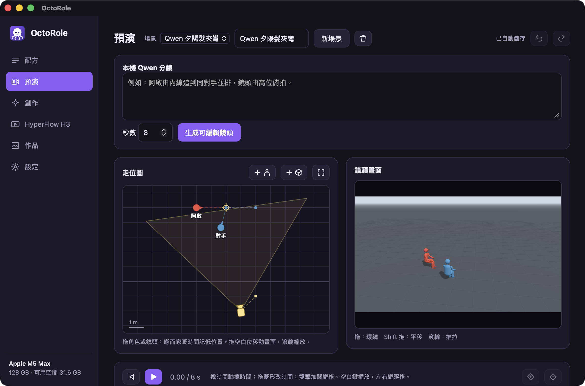
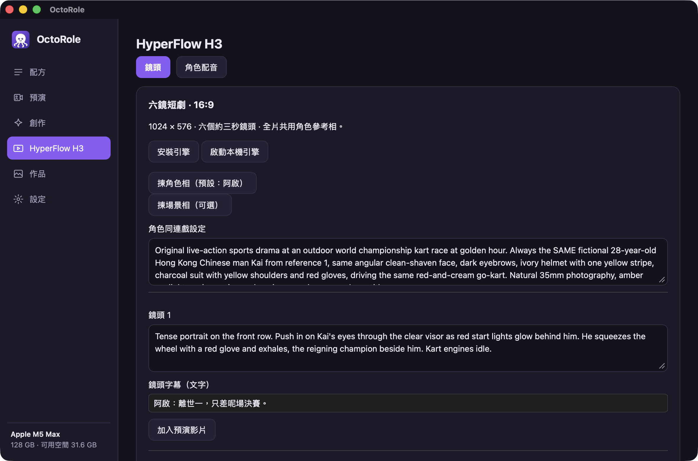
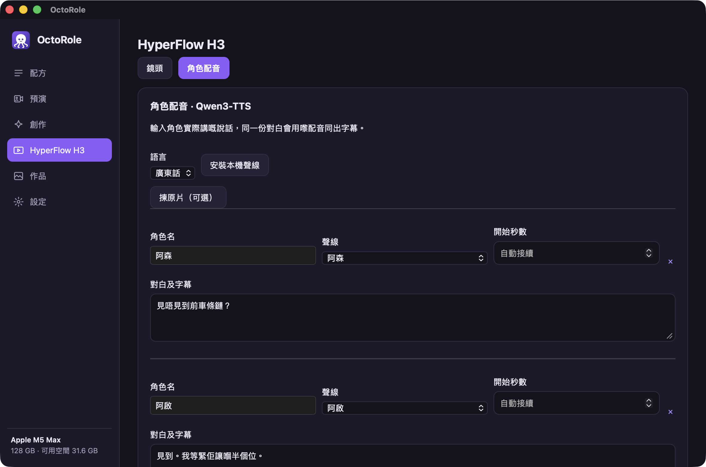
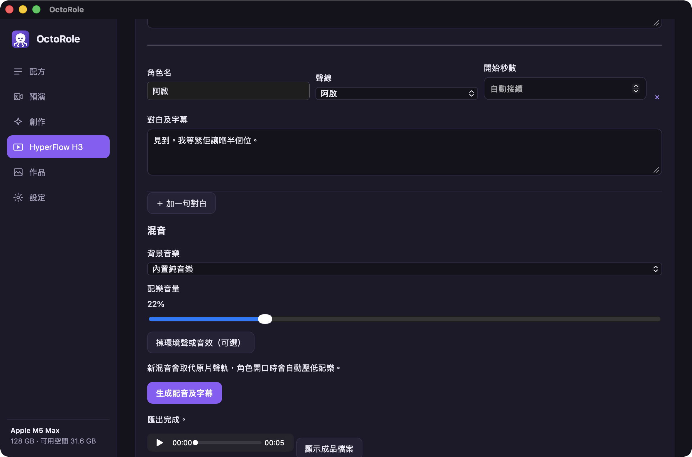

# OctoRole 0.6 實機圖解

同一套 H3 畫面可以出廣東話同普通話兩版。Qwen 負責排鏡，H3 負責生成畫面同原聲，Qwen3-TTS 負責讀出你指定嘅角色對白。

## 1. 排一個可以改嘅鏡頭

入「預演」，喺「本機 Qwen 分鏡」輸入「阿啟喺濕地髮夾彎追上白頭盔」，揀片長，再撳「生成可編輯鏡頭」。拖動走位圖嘅角色，播放檢查構圖，然後匯出預演影片。

## 2. 用同一張角色相生成六鏡

入「HyperFlow H3 → 鏡頭」。首次用先安裝、啟動本機引擎。撳「揀角色相」選一張清晰相，或者用預設阿啟。六鏡共用呢張相；喺連戲設定寫低頭盔、手套、車身顏色。每鏡改動作，需要跟預演走位就撳「加入預演影片」，然後撳「生成六鏡短劇」。參考相有助維持角色，角度同細節仍會變。

## 3. 揀語言，寫角色實際講嘅說話

轉「角色配音」。新機先撳「安裝本機聲線」，等 Terminal 顯示 Qwen3-TTS ready。揀「用最近生成嘅 H3 成片」，或者自己揀原片。選「廣東話」或「普通話」，逐行填角色名、聲線同對白。開始秒數留空會逐句接續，亦可以指定秒數。廣東話例子係「見唔見到前車條鏈？」，普通話可以寫「看得見前車的鏈條嗎？」。切換語言時，各版對白會獨立儲存。字幕跟返你輸入嘅字，想要繁體就用繁體輸入。

## 4. 混音，再匯出兩個語言版本

「背景音樂」可以關閉、揀內置純音樂或自己嘅音樂檔。用滑桿調配樂音量；要加引擎聲或雨聲，撳「揀環境聲或音效」。聲音檔由片頭開始循環，角色講嘢時自動壓低配樂。揀咗原片就撳「匯出配音 MP4」，只想試聲就撳「生成配音及字幕」。用播放器開啟字幕，或另取 SRT。撳「顯示成品檔案」搵成品，換另一種語言重做一次，會另存一套。

H3 本身亦可以按提示生成對白、音效同配樂，輸出係單一混好嘅聲軌。要聽呢種聲景，直接播放 H3 成片。角色配音匯出會取代原聲，配音對準時間，但唔會改口形。原片已有燒錄字幕時，應選返乾淨畫面，否則舊字仍然可見。

普通話使用 Qwen3-TTS CustomVoice 1.7B。廣東話使用香港粵語微調模型，以同一把基礎聲線調整音色同節奏區分角色。

[普通話模型](https://huggingface.co/mlx-community/Qwen3-TTS-12Hz-1.7B-CustomVoice-4bit) · [粵語模型](https://huggingface.co/jmtl/hk-cantonese-cc0-qwen3-tts) · [H3 聲畫提示指南](https://huggingface.co/MiniMaxAI/MiniMax-H3/blob/main/docs/VIDEO_PROMPT_WRITING_GUIDE_ref_en.md)
