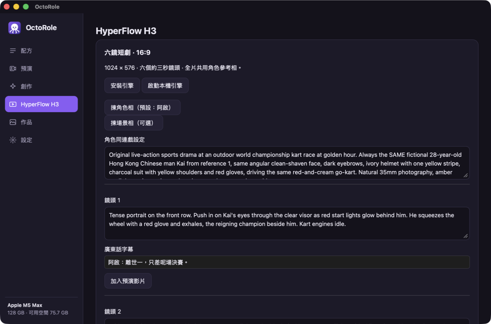

# OctoRole 0.4 · HyperFlow H3 六鏡短劇操作手冊

## 1. 開始拍《最後一圈》

喺 Finder 打開個人「應用程式」入面嘅 **OctoRole.app**。按 **⌘⇧G**，輸入 `~/Applications/OctoRole.app` 都可以。揀左邊 **HyperFlow H3**。介面可以喺「設定」切換繁體中文或英文。



1. 撳 **啟動本機引擎**。Terminal 會開啟 mlx-serve。等佢顯示開始監聽 18731，保持呢個視窗開住。如果引擎已經運行，可以直接去下一步。
2. 預設已經有香港男車手阿啟嘅人物相、角色設定、六個鏡頭同廣東話字幕。「揀角色相」只喺換演員時先要用。
3. 撳 **生成六鏡短劇**。畫面會顯示而家生成第幾鏡。第一次用新劇本要等；生成期間保持部 Mac 清醒。
4. 完成後撳 **顯示成片** 或去 **作品** 播放。預設輸出係 `~/OctoRole/works/`，用咗自訂資料夾就喺該資料夾入面嘅 `works/`。用 QuickTime 播放時，可喺「顯示方式 → 字幕」揀粵語字幕軌。
5. 如果引擎係由你喺 Terminal 啟動，完成所有生成後可以返去嗰個視窗按 **Control-C** 釋放模型記憶體。

每鏡以 1024 × 576、24 fps、73 格、6 個生成步驟製作。六鏡合共 438 格，即 **18.25 秒**。剪接保留引擎嘅環境聲；廣東話文字會加入可開關嘅字幕軌。字幕唔會自動變成配音。

## 2. 用同一個演員拍新劇情

| 設定 | 點填 | 影響 |
|---|---|---|
| 角色相 | 選一張清晰見到眼、面形、髮型或頭盔嘅人物相 | 每鏡都收到同一張參考相 |
| 角色同連戲設定 | 寫清人物、服裝、車身顏色、場景同光線。換相後一齊改呢段 | 每鏡都收到同一段設定 |
| 場景相 | 可選一張場地照片，例如髮夾彎入口 | 做第二張參考相 |
| 每鏡提示詞 | 指定景別、演員動作、鏡頭運動。三秒內集中做一件事 | 只影響嗰一鏡 |
| 廣東話字幕 | 每格填一句，控制字數，讓觀眾三秒內讀完 | 更新字幕只需重新合成 |
| 預演影片 | 喺「預演」排好走位同鏡頭，匯出參考影片，再返呢頁喺相應鏡頭撳「加入預演影片」 | 片段會等比例縮放並補邊至 16:9，轉 24 fps，長片取頭 73 格，短片定格補足 |

預設六鏡係「排頭位 → 起步失手 → 最後一圈追近 → 入彎反超 → 衝線 → 捧盃」。可以逐鏡改。人物相提供外觀引導，側面、遠鏡、遮住塊面或者換光線都可能令樣貌有偏差。要修一鏡，可以寫清動作、縮短提示或加入該鏡預演，再撳生成。程式會按輸入內容重用已完成鏡頭。改共用角色相或角色設定會令六鏡重拍。

## 3. 新 Mac 由零安裝

已經裝好並成功生成嘅 Mac 可以直接用第 1 節。以下係日後重裝或搬機步驟。

1. 使用 Apple Silicon Mac。教學引擎要求 macOS 26.2 或更新；準備約 40 GB 給模型同引擎，另留空間畀 Xcode、編譯暫存同成片。先安裝完整版 Xcode，打開一次並完成系統提示。
2. 安裝 Homebrew，再喺 Terminal 輸入以下指令。最後一行應該顯示 Metal 編譯器嘅路徑。

   ```bash
   brew install cmake webp ffmpeg
   xcode-select -p
   xcrun -f metal
   ```

   如果只裝咗 Command Line Tools，先裝完整 Xcode。若 Xcode 指出缺少 Metal Toolchain，可執行 `xcodebuild -downloadComponent MetalToolchain`。
3. 將本版本嘅 OctoRole.app 複製去 `~/Applications/`。打開 App → **HyperFlow H3 → 安裝引擎**，等 Terminal 完成。程式會編譯固定版本 mlx-serve、下載基本版 8-bit REF2VA 模型同用戶端，核對檔案 SHA-256。模型目錄係 `~/hyperflow/models/HyperFlow-H3-Flash-REF2VA-MLX-Serve-8bit/`。已驗證嘅模型會重用。
4. 跟第 1 節啟動及生成。MacBook 同 Studio 各自用本機 127.0.0.1:18731，毋須將呢個埠開放到互聯網。

**由原始碼建立 App**：喺包含 `package.json` 嘅 OctoRole 資料夾開 Terminal。裝好 Node.js、Rust 同 Xcode 後執行：

```bash
npm ci
npm run build -- --bundles app
open src-tauri/target/release/bundle/macos/OctoRole.app
```

**用命令列生成**：先啟動引擎，然後喺原始碼資料夾執行。自訂劇本可以複製 `story.json`，修改 `identity`、六段 `shots` 同六句 `captions`，再加上 `--project "/完整路徑/劇本.json"`。自訂圖片用 `character`、`scene`，逐鏡預演用六個 `blocking` 路徑；空字串表示該鏡自由生成。

```bash
/usr/bin/python3 src-tauri/hyperflow/render.py
```

## 4. 遇到問題

- **連唔到引擎**：睇啟動引擎嘅 Terminal，等模型載入。執行 `curl -fsS http://127.0.0.1:18731/v1/models`，應該見到 `HyperFlow-H3-Flash-REF2VA-MLX-Serve-8bit`。
- **中途失敗或重開 App**：保留原有片庫同劇本，再撳生成。完成嘅單鏡喺片庫 `hyperflow/shots/`。每條成片旁邊嘅 `.mp4.json` 記低劇本同六段來源。
- **校驗失敗**：留意 Terminal 指出嘅檔名。將該檔案對應嘅 `.part` 移去另一個資料夾，再跑「安裝引擎」重試。
- **瀏覽器預覽冇得生成**：開 Finder 入面嘅 OctoRole.app。瀏覽器預覽只用示範資料。
- **鏡頭出現多餘車手或動作偏差**：在該鏡指定一個動作同鏡位；如果需要固定超車路線，用一段預演引導。重新生成後比較嗰一鏡。

[引擎版本](https://github.com/ddalcu/mlx-serve/commit/28d95dfc07be2afc4054657ab739feee35536565) · [模型使用條款](https://huggingface.co/hancheng-ai/HyperFlow-H3-Flash-REF2VA-MLX-Serve-8bit/blob/f3083be2f6af4aec06416967381296f7336afe7d/LICENSE)

## 5. 今次實拍素材

角色係虛構成年香港車手阿啟，人物參考相由內置 ImageGen 製作。[角色參考相](../src-tauri/hyperflow/driver.png) · [完整分鏡、角色提示同字幕](../src-tauri/hyperflow/story.json)。

<details><summary>角色參考相生成提示詞</summary>

Single reference photograph, widescreen 16:9. A fictional 28-year-old Hong Kong Chinese male professional go-kart driver, striking and realistically human, angular lean oval face, straight thick eyebrows, small notch in right brow, clean shaven, short black hair. He sits behind the steering wheel of a low red and cream competitive kart with four black slick tires; real competition outdoor karting track, at golden hour with red-white curbs. Ivory motorsport helmet with a single yellow center stripe and clear visor raised enough to clearly see his eyes and entire face; charcoal black racing suit with bright yellow shoulders and red gloves. Chest-up to medium-wide three-quarter view including the front of the kart, gaze toward the starting line, face lit clearly. Tactile real live-action sports cinematography with authentic track atmosphere. One adult man, no fruits, no cartoons, no logos or text.

</details>
