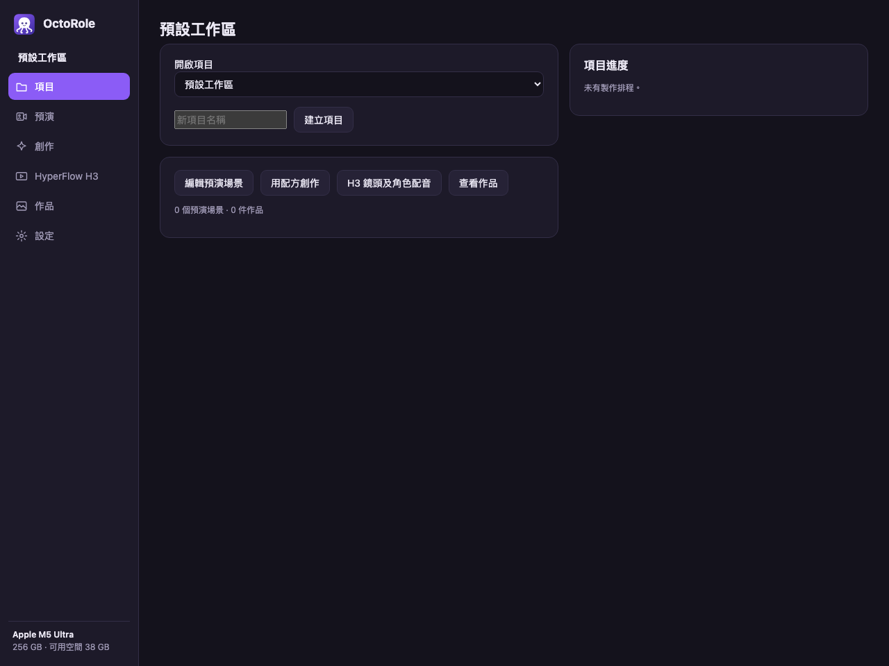
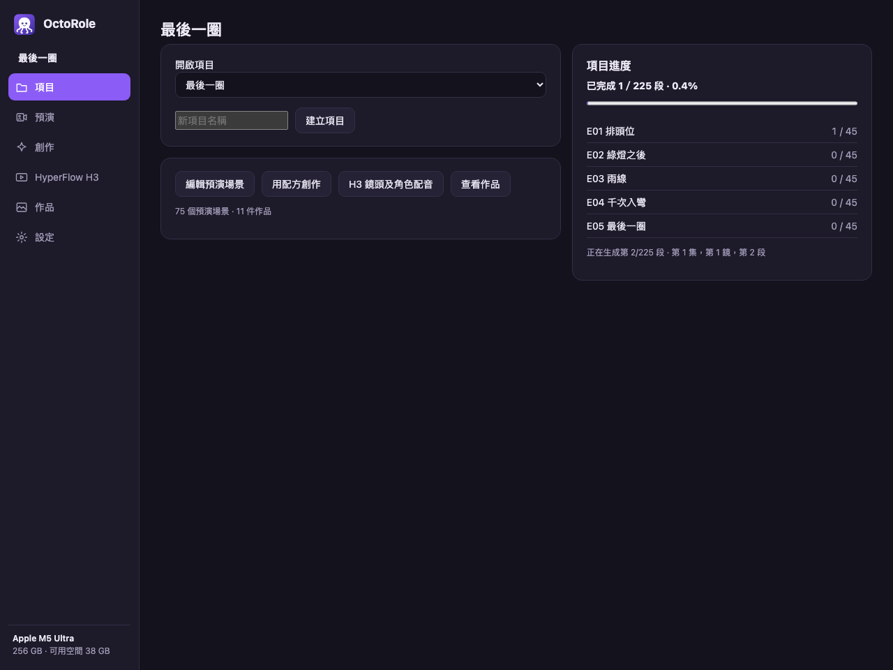
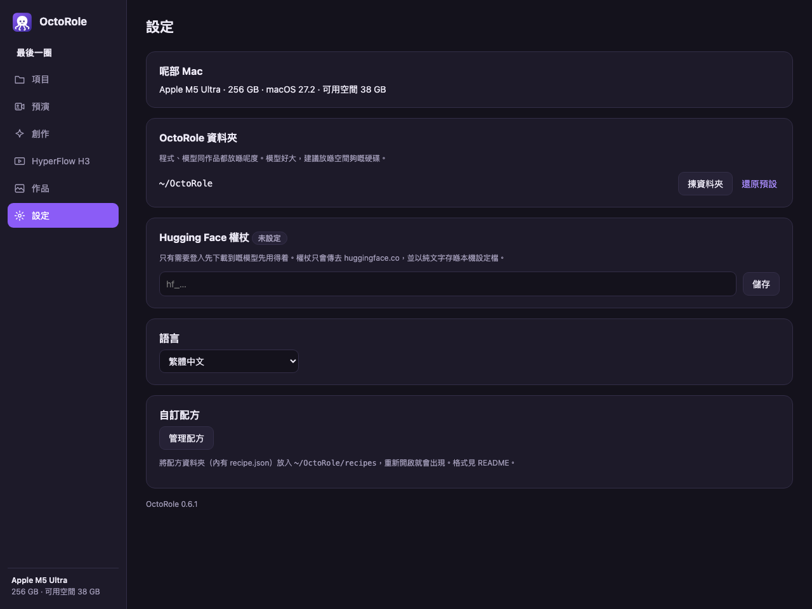

# OctoRole v0.6.1 項目操作教學

用《最後一圈》做例子，由開項目到搵返廣東話、普通話成片。[廣東話教學影片](tutorial/OctoRole-0.6.1-projects-yue.mp4) · [繁體字幕 SRT](tutorial/OctoRole-0.6.1-projects-yue.srt)

安裝前先撳  →「關於此 Mac」睇晶片同系統版本。下載包適用於 M 系列 Mac；使用本教學嘅 H3 引擎需要 macOS 26.2 或更新。[硬件要求同實測配置](../README.md#下載及安裝-v061)

### 1. 建立或開啟項目

解壓安裝包，將 OctoRole.app 拖入「應用程式」後開啟。喺左邊撳「項目」，輸入劇名，再撳「建立項目」。下次喺「開啟項目」下拉選單揀返個名。升級之前已經整好嘅場景同影片，可以喺「預設工作區」搵返。

### 2. 入項目排鏡、生成同配音

- 撳「編輯預演場景」。例如輸入「阿啟望住起步燈，收緊紅手套」，用本機 Qwen 生成可編輯鏡頭，再調整角色走位同鏡位。
- 撳「H3 鏡頭及角色配音」。內置六鏡流程可以揀一張共用角色相、逐鏡改描述，再生成短片。拍人面時，用近鏡構圖，並用清晰角色相對照眼形、頭盔同面部輪廓。
- 去「角色配音」揀畫面，填角色名、聲線同實際對白。廣東話同普通話分開匯出。字幕跟輸入文字；要繁體字幕，就輸入繁體字。[分鏡、雙語對白、字幕及混音圖解](Dialogue-Walkthrough.md)

### 3. 睇右邊嘅「項目進度」

返「項目」頁。右邊每五秒更新一次。下圖用《最後一圈》嘅製作數據示範：全劇五集，每集 45 段。畫面顯示「已完成 1／225 段 · 0.4%」，下面嘅紀錄顯示而家生成緊第 2 段。開始生成一段，同完成一段，係兩個唔同時間點。

內置六鏡流程會自動登記進度。呢個五集例子另外接駁咗外部 H3 批次，同一段嘅廣東話同普通話輸出齊備先計完成。安裝 App 後，新項目初時係空白。要接入自己嘅批次，請睇 [README 嘅進度表格式](../README.md#項目工作流程)。

### 4. 睇作品，同管理其他配方

撳「查看作品」，揀一條片播放，或者撳「顯示資料夾」搵檔案。《最後一圈》嘅「1080p 放大預覽」沿用原有畫面；「H3 原生 1080p 面部試鏡」係用角色相重新生成嘅特寫。

用 Qwen 排鏡同用 H3 拍片，可以直接揀「預演」同「HyperFlow H3」。想使用其他配方生成素材，就喺「設定 → 管理配方」安裝或啟動引擎，再入「創作」。當可用配方多過一個，側欄先會顯示獨立「配方」入口。

教學截圖同影片使用 v0.6.1 介面配示範資料製作。圖中嘅進度係教學快照。
