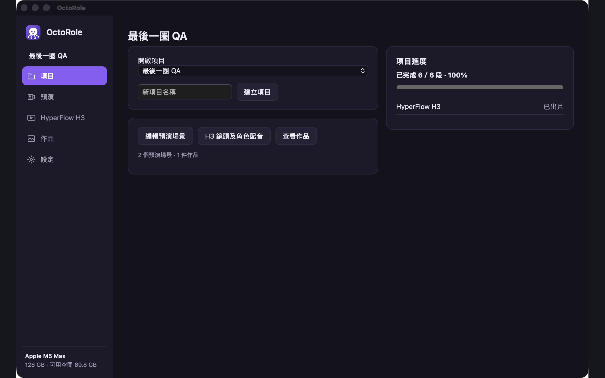
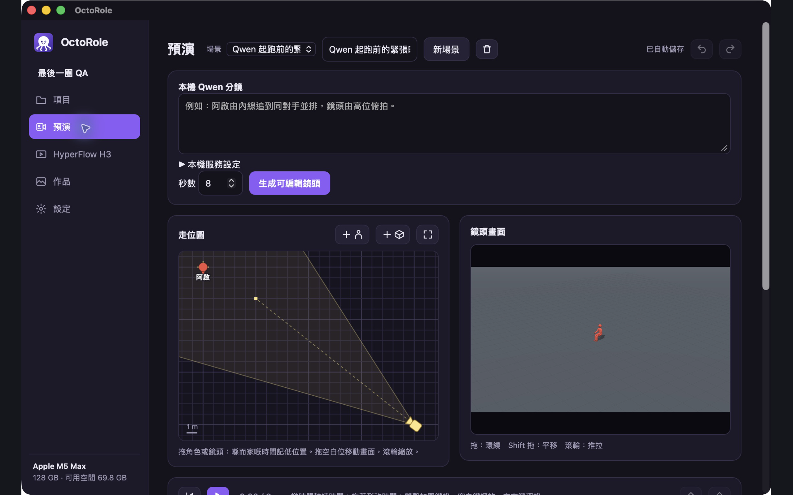
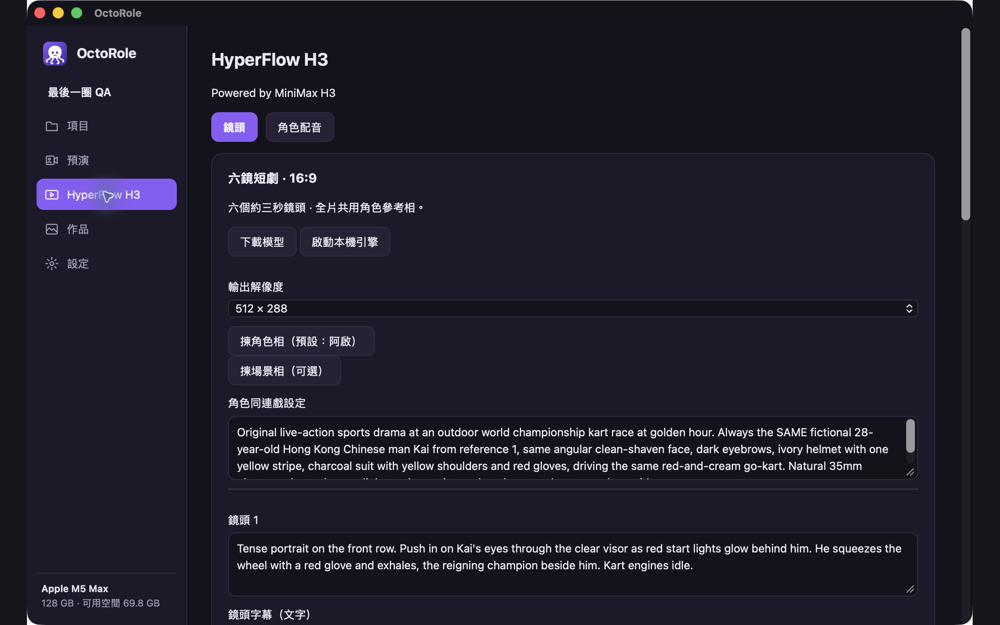

# OctoRole macOS 商店版測試

此工作目錄供測試商店版。公開下載版保留原有安裝流程。

## 在 App 預演

1. 在「項目」輸入名稱，選「建立項目」。
2. 啟動本機 Qwen 文字服務。在「預演」輸入描述，例如「阿啟戴上頭盔，望向起跑燈，鏡頭由遠拉近」。
3. 如使用自訂埠或啟用了 API 金鑰，在「本機服務設定」填寫。App 只連接本機回環位址。按「生成可編輯鏡頭」後，可以更改角色走位和鏡頭，並匯出預演影片。

## 在 App 製作六鏡影片

1. 在「HyperFlow H3」按「下載模型」。大型模型存放在 App 容器，首次使用需要額外下載空間。此步驟會按固定版本核對各檔案的 SHA-256。
2. 模型就緒後按「啟動本機引擎」。選角色參考相、修改六個鏡頭描述，並按需要為個別鏡頭加入預演影片。
3. 選擇解像度，按「生成六鏡短劇」。已完成的鏡頭保存在當前項目，重試時可重用。
4. 在「角色配音」選影片及語言，逐行填寫角色、對白及時間。可加入原創配樂，再匯出成片。
5. 要交付雙語版本，分開生成廣東話版及普通話版。每份成片使用所選語言的對白，字幕可在播放器內開關。

## Build host

The H3 engine and its native dependency paths are staged by `scripts/stage-h3-macos.sh`. The build machine supplies the pinned engine and WebP libraries. `scripts/build-media-macos.sh` takes a clean FFmpeg 7.1.1 source tree and an app Contents directory. It builds LGPL shared libraries and the VideoToolbox encoder. `scripts/stage-voices-macos.sh` stages the standalone CPython 3.11 runtime, the matching MLX Audio environment and the two prepared voice models. These tools run on the build machine.

The main sandbox and inherited child entitlements are in this directory. After staging the native components and setting the build number, run `python3 scripts/prepare-store-signatures.py /path/to/OctoRole.app "$SIGNING_IDENTITY"` using the company’s Apple Development identity. It sets each embedded Mach-O signing identifier to its embedded bundle identifier when present, or its filename otherwise, preserves the staged sandbox entitlements, and verifies the app. Export the resulting archive with the company’s App Store distribution signing and check the build’s processing status in App Store Connect.
